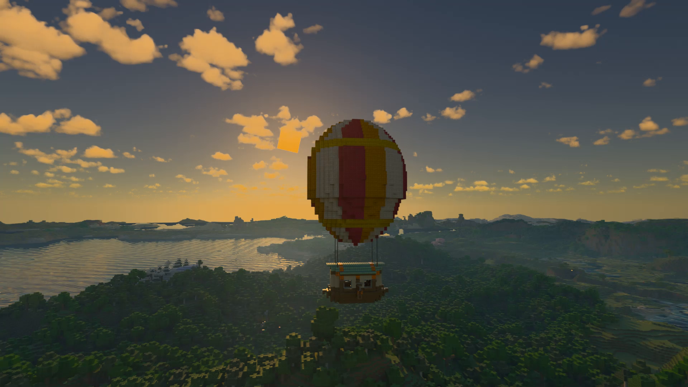

<p align="center">
  
</p>

<h1 align="center">
  Radiance
  <br>

  <a href="https://github.com/Minecraft-Radiance/Radiance">
    
  </a>

  <a href="https://discord.gg/y4Uzf6acqk">
    
  </a>

  <a href="https://modrinth.com/mod/radiance-mod-windows">
    
  </a>

  <a href="https://modrinth.com/mod/radiance-mod-linux">
    
  </a>

  <a href="https://www.curseforge.com/minecraft/mc-mods/radiance">
  
  </a>

  <a href="https://github.com/Minecraft-Radiance/Radiance/blob/main/LICENCE">
    
  </a>

  <a href="https://github.com/Minecraft-Radiance/Radiance/releases">
    
  </a>

  <a href="https://www.youtube.com/@RadianceMod">
    
  </a>

  <a href="https://b23.tv/bN7CTv1">
    
  </a>

  <br><br>
</h1>

[English](README.md) | 简体中文

# Radiance

[Radiance](https://www.minecraft-radiance.com/) 为 Minecraft 带来 Vulkan 世界渲染和硬件光线追踪。**0.1.6-alpha** 新增 DLSS 与 FSR 帧生成，扩展 Minecraft 版本及加载器支持，并改进光照、材质、性能与稳定性。



[Modrinth — Windows](https://modrinth.com/mod/radiance-mod-windows) · [Modrinth — Linux](https://modrinth.com/mod/radiance-mod-linux) · [CurseForge](https://www.curseforge.com/minecraft/mc-mods/radiance)

## 主要功能

- 世界、实体、光照、反射及透明材质的硬件光线追踪。
- Advanced 光影的大气、云、雾、水体，以及雨天表面湿润效果。
- DLSS Ray Reconstruction、NRD + DLSS Super Resolution / FSR，以及受支持硬件上的 DLSS / FSR 帧生成。
- 为 Distant Horizons、Flywheel / Create 与 Sable 提供专门的渲染适配。
- OpenGL 界面渲染与 Vulkan 世界渲染协同工作。

本仓库是模组的 Java 部分。原生渲染器位于 [MCVR](https://github.com/Minecraft-Radiance/MCVR)，Advanced 光影源码位于 [Shaderpack-Advanced](https://github.com/Minecraft-Radiance/Shaderpack-Advanced)。

## 支持范围

Radiance 是支持 **64 位 Windows 和 Linux** 的**客户端模组**，后续计划支持 **macOS**（最近刚拿到一台 Mac 笔记本用于开发）。

| Minecraft | Fabric 源码 | Forge 源码 | NeoForge 源码 | Java |
| --- | --- | --- | --- | --- |
| 1.20.1 | [Fabric](https://github.com/Minecraft-Radiance/Radiance/tree/release-0.1.6-1.20.1-fabric) | [Forge](https://github.com/Minecraft-Radiance/Radiance/tree/release-0.1.6-1.20.1-forge) | [NeoForge](https://github.com/Minecraft-Radiance/Radiance/tree/release-0.1.6-1.20.1-neoforge) | 17 |
| 1.21.1 | [Fabric](https://github.com/Minecraft-Radiance/Radiance/tree/release-0.1.6-1.21.1-fabric) | [Forge](https://github.com/Minecraft-Radiance/Radiance/tree/release-0.1.6-1.21.1-forge) | [NeoForge](https://github.com/Minecraft-Radiance/Radiance/tree/release-0.1.6-1.21.1-neoforge) | 21 |
| 1.21.4 | [Fabric](https://github.com/Minecraft-Radiance/Radiance/tree/release-0.1.6-1.21.4-fabric) | [Forge](https://github.com/Minecraft-Radiance/Radiance/tree/release-0.1.6-1.21.4-forge) | [NeoForge](https://github.com/Minecraft-Radiance/Radiance/tree/release-0.1.6-1.21.4-neoforge) | 21 |
| **26.x（移植中）** | — | — | — | — |

## 安装

1. 安装对应版本的 Minecraft 和加载器。Fabric 版本还需要 [Fabric API](https://modrinth.com/mod/fabric-api)。
2. 下载匹配 Minecraft 版本、加载器和操作系统的 Radiance JAR，放入游戏实例的 `mods` 目录。
3. **Forge 和 NeoForge 必须直接使用高性能显卡启动。**
4. Windows 用户安装 [Microsoft Visual C++ v14 x64 运行库](https://learn.microsoft.com/zh-cn/cpp/windows/latest-supported-vc-redist)。
5. 若要使用 DLSS，按下节安装可选的 NVIDIA 运行库；也可以使用可用的 NRD + FSR 管线。

### Windows 修复：调整 JDK 的运行库

部分 JDK 的 `bin` 目录自带较旧的 MSVC 运行库 DLL。即使安装了最新版 Visual C++ 运行库，Windows 仍可能优先加载 JDK 自带的旧文件。这种版本不匹配可能导致原生代码在 `std::mutex::lock` 处崩溃，详见这个已知的 [MSVC 运行库兼容问题](https://github.com/microsoft/STL/issues/4730)。

如果因此在启动时崩溃：

1. 关闭游戏和启动器，打开启动器实际使用的 Java 安装目录下的 `bin` 文件夹（`<JDK>/bin`）。
2. 将其中的 `msvcp140.dll`、`vcruntime140.dll` 和 `vcruntime140_1.dll` 添加 `.bak` 后缀，或移到备份目录，使 Java 不再加载这些自带的旧运行库。
3. 安装[最新的 Microsoft Visual C++ v14 x64 运行库](https://learn.microsoft.com/zh-cn/cpp/windows/latest-supported-vc-redist)，然后重新启动启动器和游戏，让 Java 使用更新后的系统运行库。

### 可选的 DLSS 运行库

以下路径均相对于**游戏实例目录**。启动器开启版本隔离后，这个目录可能与启动器主 `.minecraft` 目录不同。

Radiance 不附带、也不会自动下载 NVIDIA DLSS 运行库。请从 [NVIDIA 官方 DLSS 仓库](https://github.com/NVIDIA/DLSS) 获取 release 版本的文件，遵循其许可条款，并放入 `<实例目录>/radiance/`。目录不存在时可自行创建。

| 功能 | Windows | Linux |
| --- | --- | --- |
| 超分辨率 | `nvngx_dlss.dll` | `libnvidia-ngx-dlss.so.<version>` |
| 光线重建 | `nvngx_dlssd.dll` | `libnvidia-ngx-dlssd.so.<version>` |
| 帧生成 | `nvngx_dlssg.dll` | `libnvidia-ngx-dlssg.so.<version>` |

官方下载目录：[Windows](https://github.com/NVIDIA/DLSS/tree/v310.9.1/lib/Windows_x86_64/rel) · [Linux](https://github.com/NVIDIA/DLSS/tree/v310.9.1/lib/Linux_x86_64/rel)。保留原始文件名，并使用同一发布版本的运行库；上述链接对应的 Linux 文件版本后缀为 `310.9.1`。

DLSS 需要兼容的 NVIDIA 显卡。超分辨率、光线重建、帧生成分别检测能力，支持其中一项不代表全部支持。缺失或不受支持的 DLSS 功能不会成为可选管线，不需要创建同名空白 DLL 或 SO 文件。

## 模组兼容

下表列出已提供专门渲染适配的模组；其他模组也可能无需特殊适配即可兼容。如有兼容需求或希望贡献适配，欢迎提交 [Issue](https://github.com/Minecraft-Radiance/Radiance/issues) 或 [Pull Request](https://github.com/Minecraft-Radiance/Radiance/pulls)。

| Minecraft / 加载器 | Distant Horizons | Flywheel | Sable |
| --- | --- | --- | --- |
| 1.20.1 Fabric | 3.3.0 | 1.0.1–1.0.6 | — |
| 1.20.1 Forge / NeoForge | 3.3.0 | 1.0.1–1.0.6-281 | — |
| 1.21.1 Fabric | 3.3.1 或 3.3.2 | 1.0.1–1.0.6 | 2.0.5 |
| 1.21.1 NeoForge | 3.3.1 或 3.3.2 | 1.0.1–1.0.6-44 | 2.0.5 |
| 1.21.4 Fabric / NeoForge | 3.3.1 | — | — |
| 1.21.1 / 1.21.4 Forge | — | — | — |

## FAQ

### 如何清理缓存？

遇到问题时，可以尝试先退出游戏，清空游戏实例目录下的 `radiance` 文件夹后重启游戏。如果需要使用 DLSS，可以保留其中的 DLSS 运行库文件。

### 为什么 Forge / NeoForge 要直接使用高性能显卡启动？

Forge 和 NeoForge 会在 Radiance 初始化之前，为早期加载窗口创建 OpenGL 上下文。Radiance 的 Vulkan 渲染器必须使用同一块显卡，因此游戏必须直接使用高性能显卡启动。

### 提示 OpenGL 扩展缺失或显卡不匹配怎么办？

如果错误提到 `GL_EXT_memory_object`、`GL_EXT_semaphore`，或 Vulkan 显卡无法匹配 OpenGL UI 上下文，应检查 Java 实际使用的显卡，更新显卡驱动并重新启动游戏。

### 为什么不能选择某种 DLSS 或帧生成模式？

该模式需要匹配的硬件、驱动和运行库。如果该模式不可用，可以尝试更新显卡驱动。DLSS 帧生成与 DLSS 重建有独立的硬件要求。AMD、Intel 用户可选择可用的 NRD + FSR 管线；FSR 帧生成同样以 Radiance 检测到的能力为准。设置界面会列出可用模式和倍率。

### 必须安装 PBR 材质包吗？

Radiance 内置部分发光纹理数据，搭配 PBR 材质包可以获得更丰富的材质细节。从 0.1.4 起无需预处理，按普通资源包加载即可。材质和视差效果需要纹理包含相应的 PBR 通道。

## 构建

从上方表格选择对应 Minecraft 版本与加载器的源码分支，准备匹配的 Java 工具链，并使用 **0.1.6 的 MCVR 源码**。

在 Java 仓库生成 JNI 头文件：

```sh
./gradlew compileJava -PradianceUiBackend=opengl
```

按照 [MCVR 构建说明](https://github.com/Minecraft-Radiance/MCVR#build)编译并安装原生组件，使用 `-DMCVR_UI_BACKEND=OPENGL`，并将 `JAVA_PROJECT_ROOT_DIR` 指向当前 Java 仓库的绝对路径。然后返回 Java 仓库打包：

```sh
./gradlew build -PradianceUiBackend=opengl
```

Windows 使用 `gradlew.bat`。JAR 输出到 `build/libs/`，发布时选择普通模组 JAR。若要构建 Vulkan UI 版本，两次 Gradle 命令均使用 `-PradianceUiBackend=vulkan`，CMake 使用 `-DMCVR_UI_BACKEND=VULKAN`，并采用独立的原生构建目录。各 Minecraft / 加载器组合必须使用各自生成的 JNI 头文件。

## 致谢

感谢 [Vulkan](https://www.vulkan.org/)、[NVIDIA DLSS](https://github.com/NVIDIA/DLSS)、[AMD FSR](https://gpuopen.com/fidelityfx-super-resolution-3/)、[Intel XeSS](https://github.com/intel/xess)、[NRD](https://github.com/NVIDIA-RTX/NRD)、[SHARC](https://github.com/NVIDIA-RTX/SHARC)，以及 GLFW、GLM、STB、VMA 等项目及其贡献者。

## 免责声明

本项目是社区开发的第三方模组，不隶属于 Mojang、Microsoft 或 NVIDIA，亦未获得其赞助或认可。Minecraft 及其他名称、标识属于各自权利人。**NOT AN OFFICIAL MINECRAFT SERVICE. NOT APPROVED BY OR ASSOCIATED WITH MOJANG OR MICROSOFT.**

本项目按“原样”提供，不作任何担保；使用前请备份存档和配置。许可证见 [LICENCE](LICENCE)。
